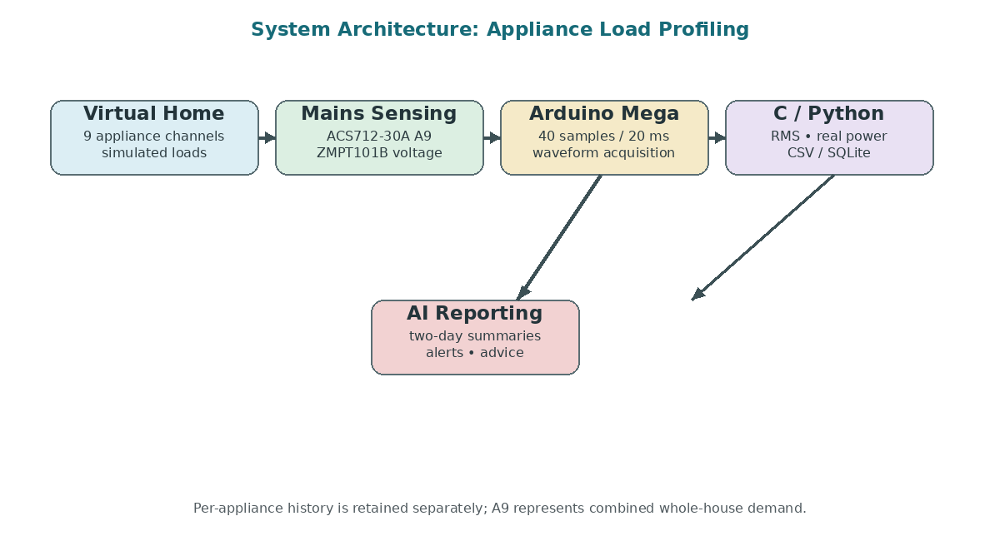
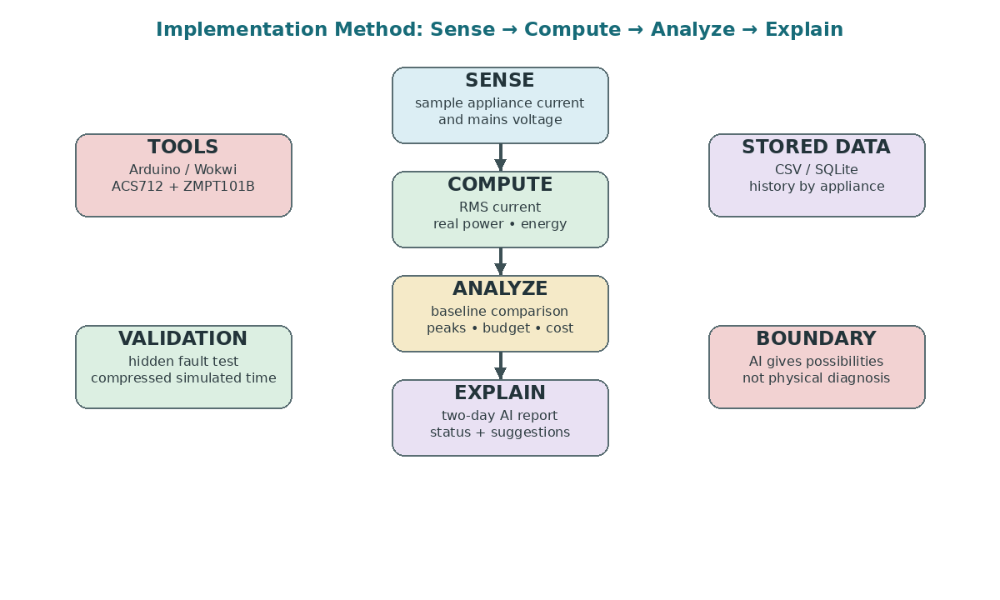
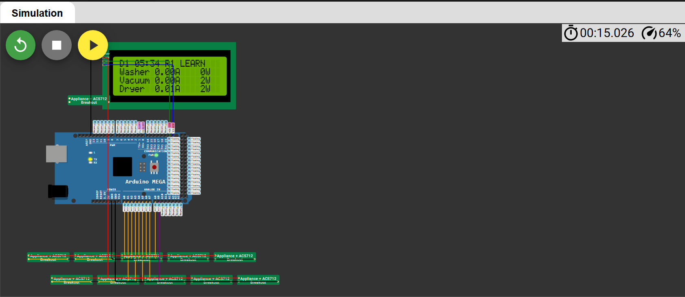
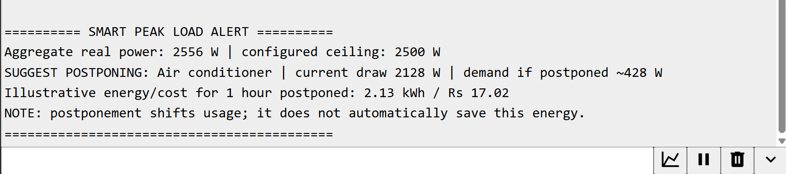
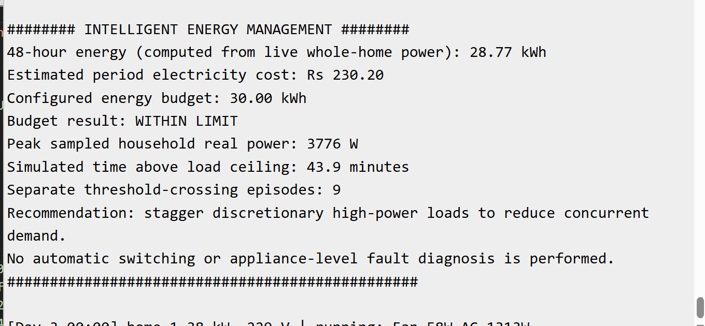

# CASE STUDY REPORT
## AI-Based Appliance Load Profiling and Energy Monitoring
### Simulation-based sensing · Real-power analysis · Intelligent energy decisions
**Embedded Systems + C/Python + Data Analysis + AI Integration**

| Course / document type | Case Study Report |
| :--- | :--- |
| **Project title** | AI-Based Appliance Load Profiling and Energy Monitoring |
| **Team members** | P. Shasank · Dhanvant Menon · Gowshik Raam · Ramakkrishnayya BV. |
| **Roll numbers** | CB.SC.U4CSE25645 · CB.SC.U4CSE25613 · CB.SC.U4CSE25622 · CB.SC.U4CSE25608 |
| **Platform** | Arduino Mega / Wokwi + C/Python + CSV/SQLite + AI reporting |
| **Date** | 28 October 2026 |

---

## 1. Title
**AI-Based Appliance Load Profiling and Energy Monitoring** using simulation-based sensing, real-power analysis, historical baselines, peak alerts, budget forecasting, cost estimation, and AI-assisted reporting.

---

## 2. Team Members
* **P. Shasank** — `CB.SC.U4CSE25645` (`paruchurishasank04@gmail.com`)
* **Dhanvant Menon** — `CB.SC.U4CSE25613` (`dhanvantmenon@gmail.com`)
* **Gowshik Raam** — `CB.SC.U4CSE25622` (`rtgraam06@gmail.com`)
* **Ramakkrishnayya BV.** — `CB.SC.U4CSE25608` (`bvram8033@gmail.com`)

---

## 3. Project Links
* **Interactive Simulation (Wokwi):** [https://wokwi.com/projects/478059293315011585](https://wokwi.com/projects/478059293315011585)
* **GitHub Repository:** [https://github.com/dhanVant-core/C-case-study](https://github.com/dhanVant-core/C-case-study)

---

## 4. Project Scope
This case study covers a simulation-based virtual home in which nine appliance channels and a whole-house mains channel are monitored. Arduino/Wokwi models current sensing, while computer-side C/Python processing computes electrical measurements, stores history, detects changes, forecasts usage, estimates cost, and prepares structured inputs for a two-day AI report.

* **In scope:** Nine appliance channels, mains current and voltage sensing, RMS current, real power, energy accumulation, operating hours and starts.
* **In scope:** Historical baseline comparison, drift/anomaly checks, peak-load alerts, energy-budget forecasting, and configurable tariff-based cost estimation.
* **In scope:** Two-day AI summaries with `NORMAL` / `HIGH USAGE` / `ATTENTION` status, possible explanations, and practical suggestions.
* **Out of scope:** Real-appliance field measurements, confirmed physical-fault diagnosis, safety-certified mains hardware, and guaranteed electricity-bill prediction.

---

## 5. Objective
The objective is to build a virtual energy-monitoring pipeline that moves beyond a single monthly electricity total and provides appliance-level, time-based, and actionable information.
1. Measure simulated appliance current and mains voltage using modeled sensors.
2. Compute RMS current, real power, and accumulated energy from sampled waveforms.
3. Retain appliance history and compare each two-day period against a healthy baseline.
4. Detect overlapping heavy loads and provide peak-demand alerts.
5. Forecast whether a configurable monthly energy budget is likely to be exceeded.
6. Convert measured energy into estimated rupee cost using a configurable tariff.
7. Turn structured analysis into an understandable two-day AI report without claiming physical fault diagnosis.

---

## 6. Already Existing Related Work
The project compares three broad approaches shown in the project presentation:
1. **Conventional Household Meter:** Exposes aggregate consumption but does not identify which appliance produced it.
2. **Dedicated Per-Appliance Sensing:** Provides reliable individual tracking, but requires more sensors and wiring.
3. **Single-Sensor Non-Intrusive Load Monitoring (NILM):** Estimates appliance operation from aggregate electrical signatures, but identification becomes uncertain when different appliances have similar signatures (e.g., two electrically similar refrigerators cannot be uniquely identified from aggregate current alone).

The updated system uses dedicated-channel simulation while retaining a mains channel for combined-demand analysis. A future hybrid option can combine dedicated channels for critical or electrically similar appliances and aggregate sensing for the rest.

---

## 7. The Proposed Idea
The central idea is to treat the virtual home as a continuous monitoring pipeline rather than a simple energy meter. Each appliance has a known simulated channel. Waveform samples are converted into RMS current, real power, and energy; behavioral features are retained; the latest period is compared with historical behavior; and the results are converted into alerts, forecasts, cost information, and a readable AI report.

### Key Improvements over Review 2
* **Sensing:** Moved from separate current channels to nine appliance channels plus mains sensing (ACS712-30A and ZMPT101B voltage).
* **Power Math:** Shifted from $V \times I$ approximation to sampled $v(t) \times i(t)$ true real power.
* **Analysis:** Progressed from signature-only analysis to historical baselines and drift checks.
* **Reporting:** Advanced from a basic two-day summary to peak alerts, budget forecasting, rupee cost, and actionable postponement recommendations.

---

## 8. Implementation: Algorithm, Tools, and Method

### 8.1 Tools and Method
* **Simulation:** Arduino/Wokwi virtual appliance and sensor environment.
* **Microcontroller side:** Arduino Mega 2560; ACS712 models on A0–A8 and ACS712-30A on A9 for whole-house current.
* **Voltage sensing:** ZMPT101B model on A9.
* **Sampling:** 40 samples over 20 ms (50 Hz mains period).
* **Analysis/storage:** C/Python processing with CSV / SQLite history.
* **Reporting:** Structured analysis summary passed to an AI layer for a two-day user-facing report.

### 8.2 Core Algorithms
* **RMS current:** Calculated over sampled current values:
  $$I_{RMS} = \sqrt{\frac{1}{n} \sum I^2}$$
* **Real power:** Calculated as the average of sampled voltage-current products:
  $$P = \text{average}[v(t) \times i(t)]$$
* **Energy accumulation:**
  $$\text{Energy (kWh)} = \frac{\sum P \times t}{1000 \times 3600}$$
* **Anomaly detection:** Each simulated two-day period is compared with the appliance's healthy baseline:
  $$\Delta \% = \frac{\text{Current} - \text{Baseline}}{\text{Baseline}} \times 100$$
* **Peak-load logic:** Combined mains demand is checked against a configurable ceiling limit (e.g. 2500 W / 4000 W). If exceeded, deferrable loads are evaluated and postponement is recommended.
* **Budget forecasting:** Linear rate-based usage projection:
  $$\text{Projected} = \text{Consumed} \times \left(\frac{T_{\text{period}}}{T_{\text{elapsed}}}\right)$$
* **Cost estimation:**
  $$\text{Cost (Rs)} = \text{Energy (kWh)} \times \text{Tariff (Rs/kWh)}$$

### 8.3 Architecture Diagram

*Figure 1. System architecture of the simulation-based appliance monitoring pipeline.*

### 8.4 Algorithm / Method Diagram

*Figure 2. Sense–compute–analyze–explain workflow and validation boundary.*

### 8.5 Sensor Mapping Table
| Room | Appliance | Channel | Sensor Model | Rated Current |
| :--- | :--- | :---: | :--- | :---: |
| **Kitchen** | Fridge | `A0` | ACS712-20A | 0.9 A |
| **Kitchen** | Microwave | `A1` | ACS712-20A | 5.3 A |
| **Kitchen** | Dishwasher | `A2` | ACS712-20A | 9.3 A |
| **Living room** | TV | `A3` | ACS712-5A | 0.5 A |
| **Living room** | Ceiling fan | `A4` | ACS712-5A | 0.3 A |
| **Living room** | Vacuum cleaner | `A7` | ACS712-20A | 6.0 A |
| **Bedroom** | Air conditioner | `A5` | ACS712-30A | 6.2 A |
| **Utility** | Washing machine | `A6` | ACS712-20A | 8.4 A |
| **Utility** | Clothes dryer | `A8` | ACS712-20A | 10.5 A |
| **Whole house** | Mains current / voltage | `A9` | ACS712-30A / ZMPT101B | 30.0 A / 230 V |

---

## 9. AI / Hardware / Software Specification Used
| Item | Specification / Role |
| :--- | :--- |
| **Microcontroller** | Arduino Mega 2560 simulation; waveform sample acquisition |
| **Current sensing** | ACS712 on A0–A8; ACS712-30A on A9 for mains |
| **Voltage sensing** | ZMPT101B transformer model |
| **Sampling** | 40 samples / 20 ms cycle |
| **Processing** | C / Python; RMS, real power, energy, features |
| **Storage** | CSV / SQLite; separate appliance history |
| **AI reporting** | Two-day summaries, status (`NORMAL` / `HIGH USAGE` / `ATTENTION`), possible causes, practical checks |
| **AI boundary** | Explanations and suggestions only; no physical fault diagnosis |

---

## 10. Results & Validation
| Demonstration | Expected / Shown System Behaviour | Evidence in Supplied Project Design |
| :--- | :--- | :--- |
| **Appliance-level tracking** | Nine channels retain individual measurements and history. | A0–A8 sensor mapping and per-appliance history. |
| **Real-power measurement** | Power computed from sampled $v(t) \times i(t)$ captures power factor. | Measurement method in updated design. |
| **Peak-load alert** | 5.1 kW combined demand exceeds 4.0 kW limit; postponement suggested. | Peak-load demonstration scenario. |
| **Budget forecast** | 15.0 kWh in 11 days projects to ~41 kWh/month against 36 kWh budget (Day 26 exceedance). | Rate-based forecast example. |
| **Cost estimation** | 18.5 kWh at Rs 8/kWh gives estimated Rs 148. | Configurable tariff example. |
| **AI report** | Structured measurements become `NORMAL` / `HIGH USAGE` / `ATTENTION` status. | Two-day AI reporting workflow. |
| **Hidden-fault validation** | Injected virtual-load change is flagged in the next two-day report. | Fault injection validation procedure. |

---

## 11. Result Screenshots & Evidence

### Figure 3: Virtual Nine-Appliance Home & Live Readings


### Figure 4: Smart Peak-Load Alert Output


```text
========== SMART PEAK LOAD ALERT ==========
Aggregate real power: 2556 W | configured ceiling: 2500 W
SUGGEST POSTPONING: Air conditioner | current draw 2128 W | demand if postponed ~428 W
Illustrative energy/cost for 1 hour postponed: 2.13 kWh / Rs 17.02
NOTE: postponement shifts usage; it does not automatically save this energy.
===========================================
```

### Figure 5: 48-Hour Learning & Baseline Statistics Document
```text
##### STATISTICS DOCUMENT START #####
# Virtual home statistics document, report 1 (home hours 0 to 48)
Source: one ACS712 current sensor per appliance and a ZMPT101B voltage sensor, read by an Arduino Mega.
Status: LEARNING. This period is being recorded as the healthy baseline.

## FRIDGE_01 - Refrigerator (ACS712-20A on A0)
Energy: 3.92 kWh | Cost: Rs 31.34 | Run: 22.1 h | Starts: 80.0 | Avg Power: 154 W | PF: 0.74

## MICRO_01 - Microwave (ACS712-20A on A1)
Energy: 0.39 kWh | Cost: Rs 3.11 | Run: 0.27 h | Starts: 5.0 | Peak Current: 15.6 A

## DISH_01 - Dishwasher (ACS712-20A on A2)
Energy: 2.21 kWh | Cost: Rs 17.66 | Run: 2.04 h | Starts: 4.0 | Avg Power: 1097 W | PF: 0.77

## TV_01 - Television (ACS712-5A on A3)
Energy: 1.09 kWh | Cost: Rs 8.74 | Run: 10.1 h | Starts: 4.0 | Avg Power: 105 W | PF: 0.77

## FAN_01 - Ceiling Fan (ACS712-5A on A4)
Energy: 1.43 kWh | Cost: Rs 11.48 | Run: 24.4 h | Starts: 5.0 | Avg Power: 58.4 W | PF: 0.90

## AC_01 - Air Conditioner (ACS712-30A on A5)
Energy: 14.4 kWh | Cost: Rs 115.09 | Run: 10.5 h | Starts: 40.0 | Avg Power: 1293 W | PF: 0.90

## WASH_01 - Washing Machine (ACS712-20A on A6)
Energy: 1.26 kWh | Cost: Rs 10.04 | Run: 2.63 h | Starts: 4.0 | Avg Power: 387 W | PF: 0.66

## VAC_01 - Vacuum Cleaner (ACS712-20A on A7)
Energy: 0.78 kWh | Cost: Rs 6.24 | Run: 0.57 h | Starts: 2.0 | Avg Power: 1288 W | PF: 0.94

## DRYER_01 - Clothes Dryer (ACS712-20A on A8)
Energy: 3.31 kWh | Cost: Rs 26.50 | Run: 2.22 h | Starts: 2.0 | Avg Power: 1458 W | PF: 0.83

Whole home: 28.77 kWh, Rs 230.20
##### STATISTICS DOCUMENT END #####
```

### Figure 6: Intelligent Energy Management & AI Report Output


```text
######### INTELLIGENT ENERGY MANAGEMENT #########
48-hour energy (computed from live whole-home power): 28.77 kWh
Estimated period electricity cost: Rs 230.20
Configured energy budget: 30.00 kWh
Budget result: WITHIN LIMIT
Peak sampled household real power: 3776 W
Simulated time above load ceiling: 43.9 minutes
Separate threshold-crossing episodes: 9
Recommendation: stagger discretionary high-power loads to reduce concurrent demand.
No automatic switching or appliance-level fault diagnosis is performed.
#################################################
```

---

## 12. Conclusion
The case study demonstrates a complete simulation-based path from electrical sensing to intelligent energy decisions. The updated system measures nine appliance channels and whole-house demand, computes RMS current and sampled real power, accumulates energy, retains historical behavior, detects peaks, forecasts a configurable budget, estimates cost in rupees, and prepares two-day AI reports.

The project deliberately separates measurement and deterministic analysis from AI explanation. This makes the system useful as an inspectable academic pipeline while keeping responsible boundaries: simulated outputs are not real appliance measurements, AI does not confirm physical faults, and real mains deployment would require isolation, enclosure, and safety engineering.

---

## 13. Future Work
1. Explore single-sensor NILM and signature-learning approaches to reduce the number of dedicated sensors.
2. Develop an electrical-behavior health score based on longer historical records.
3. Improve prediction accuracy using richer usage patterns instead of a simple rate-based forecast.
4. Validate the approach on physical appliances after appropriate electrical isolation and safety engineering.
5. Investigate hybrid sensing: dedicated channels for critical/similar appliances with aggregate sensing for the remainder.
6. Extend the AI layer with stronger uncertainty handling and clearer user-facing explanations.

---

## 14. References / Project Sources
* **Project Presentation:** *AI-Based Appliance Load Profiling and Energy Monitoring* — Final Project Presentation (Team 9).
* **Coursework:** Embedded Systems, C/Python, and IoT Edge Analytics Coursework.
* **Wokwi Simulator:** [https://wokwi.com/projects/478059293315011585](https://wokwi.com/projects/478059293315011585).
